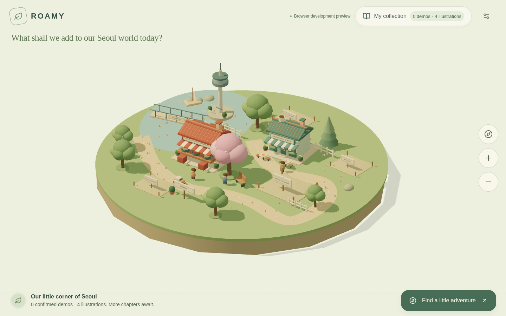

# ROAMY — a little Seoul to keep

**Drive the real world. Build your own.**

ROAMY is a local-first, stationary entertainment application with an original miniature Seoul. Four illustrative memories introduce Gwangjang Market, Namsan, Seokchon Lake and Seongsu. Four complete demo adventures add Mangwon Market, a Gyeongbokgung-inspired pavilion, Bukhansan and a Seoul museum.

The cloud build and browser experience work without a runtime server, downloaded 3D assets, accounts or API keys. **Official Pleos runtime validation remains blocked by missing KVM/GPU access on the current cloud worker. The vehicle world stays locked until its platform restriction integration is validated.** Browser previews are explicitly labeled and are not Pleos runtime evidence.



## Play the Seoul preview in the cloud

Requires Node 22.12+ (or 20.19+), npm and a cloud browser with WebGL.

```sh
cd web
npm ci
npm run dev
```

Open the cloud preview URL. **My collection → Gwangjang Market flavors → Meet your next keepsake → Find a Mangwon picnic → choose an illustrative destination → Let’s go → Simulate journey → Add to my world** records a confirmed demo memory. The reveal lasts seven seconds; reduced motion adds the finished keepsake immediately. **Not yet** records nothing.

Browse all keepsakes to choose a category or continue through Mangwon → Gyeongbokgung → Bukhansan → Seoul museum. Every advertised new keepsake has a complete discovery/confirmation flow. Collecting all four shows the completion state. Replaying an adventure never duplicates a keepsake. Edit a collected memory's note from its details; Save and Cancel are deliberate actions.

Orbit/pan/zoom are bounded; the compass reframes the island. Settings stores day/evening, mute and reduced-motion preferences. Reduced motion defaults to the system setting and stops nonessential world/camera motion. Escape closes panels and returns keyboard focus. Reset requires confirmation. The island has eight reserved sites; collection fills them rather than automatically expanding terrain over time.

Earlier Detroit/Chicago demo saves are preserved in a separately labeled legacy collection with their original names, dates and notes. They are never relabeled as Seoul visits or counted toward the Seoul collection.

## Saves, backup and privacy

The version 2 save format keeps the stable `little-world:v1` key for migration. Reads never overwrite corrupt or newer-version data. A confirmed collection is saved before animation, and storage failures show a visible session-only warning. A temporarily unreadable existing save requires an explicit restore/replace decision when storage recovers; a generic retry cannot silently replace it with initial memories.

Settings also includes a local **Open-source licenses** reader. [Dependency attribution and checks](docs/licenses/README.md) document the emitted production bundle and separate proprietary Pleos terms.

Settings includes **Backup and recovery**: prepare/copy a backup (or select text manually), review an imported text/file, then explicitly confirm replacement. Backups are bounded to 64 KiB, validate known current/legacy IDs, real dates and note length, and reject unsupported versions. Previous valid saves and deliberately replaced unreadable saves are retained for recovery until explicitly cleared. Reset removes the current additions but keeps recovery data until its separate deletion control is used.

Browser saves, manual backups and clipboard exports are **plaintext**. Do not store sensitive personal information. Nothing is uploaded by ROAMY; uninstall/clear-data removes device data, and automatic Android cloud backup/device transfer is excluded. Sensitive production data requires approved encrypted native persistence before release; sandboxing is not encryption.

## Build Android in the cloud

Use JDK 17, SDK platform 35/build-tools 35.0.0 and `ANDROID_HOME`. The Gradle 8.10.2 wrapper, AGP 8.8.2 and Kotlin 2.1.10 are pinned. Android 28 is the minimum; target 34 matches the documented official Pleos emulator baseline. Current market target policy must be reconfirmed for release.

```sh
./scripts/build-apk.sh preview
./scripts/build-apk.sh vehicle
# Or after npm ci in web:
cd android
./gradlew :app:assemblePreviewDebug :app:assembleVehicleDebug \
  :app:testPreviewDebugUnitTest :app:testVehicleDebugUnitTest \
  :app:lintPreviewDebug :app:lintVehicleDebug
```

Every build bundles the production Vite output with WebViewAssetLoader.

| Flavor | Stable package | Behavior |
| --- | --- | --- |
| Preview | `ai.littleworld.preview` | Explicit non-vehicle development preview; unavailable vehicle location/lighting and sample-only travel. |
| Vehicle | `ai.littleworld` | Official restriction observer and NaviHelper adapter; native and web safety gates; remains locked pending verified platform authorization. |

Version 0.2.0 / Android version code 2 identifies this increment. Current APKs live under `android/app/build/outputs/apk/`. Historical APKs directly under `artifacts/` belong to the earlier proof of concept. GitHub cloud CI uploads current APKs, tests, screenshots and reports. Its vehicle release artifact is explicitly unsigned and is not distributable. The required competition path is `apk/박상현_ROAMY_release.apk`; [staging instructions](apk/README.md) reject debug/unsigned builds and require an authorized signer. No APK is staged there yet. See [release signing and gates](docs/RELEASE.md) for the secure environment configuration needed to produce an authorized signed release.

## Safety and integration boundaries

The vehicle flavor observes official AAOS `CarUxRestrictionsManager`, invalidates stale/disconnected/background observations and uses an opaque native cover independent of JavaScript. Its production validation gate remains false until the official Pleos runtime matrix passes; no observer emits PARKED in the current vehicle build. There is no speed-based inference, simulated PARKED signal or user override. Renderer failure stays covered and releases resources. The web gate additionally removes the Canvas, cancels choreography and suspends audio.

NaviHelper 3.0.5 provides real service initialization, permission checks, typed route submission/search/cancellation status, retries and listener teardown. The native verified-destination registry is currently empty. No licensed accurate Seoul POI provider was supplied; illustrative destinations are rejected before SDK calls. A submitted route or completed search is never arrival or a memory confirmation. Location, cabin lighting and voice controls remain unavailable.

The native WebMessage bridge is bounded, versioned, main-frame/origin restricted, correlated and cancelable. JavaScript cannot supply native coordinates, arbitrary URLs or Android commands. The WebView serves only bundled HTTPS assets, rejects external requests/navigation and disables file/content/mixed-content access. Production CSP limits scripts and other resources to bundled origins.

Native audio focus is requested only immediately before an actual chime, not on silent selection taps. Denial, stale grants, mute, focus loss, backgrounding and display-off suppress playback; scheduled notes are removed rather than replayed on resume. Independent web/native time limits prevent indefinite focus ownership. Actual AAOS routing and speaker behavior still requires official runtime validation.

## Checks and evidence

```sh
cd web
npm test
npm run build
TEST_PRODUCTION=1 EVIDENCE_DIR=../artifacts/roamy-seoul npm run test:e2e
```

Set `CHROMIUM_PATH` for a cloud browser when it differs from `/usr/bin/chromium`. Software WebGL flags are browser test settings; they do not emulate Pleos GPU performance. The separate `verify-rendering.mjs` checks production day/evening output, console/CSP errors and the WebGL failure screen on preview port 5174. CI also builds both APK flavors and unsigned vehicle release, runs native unit tests/lint and verifies APK policy/signatures/bundled assets.

- [Current implementation roadmap and acceptance criteria](docs/ROADMAP.md)
- [Official Pleos cloud feasibility](docs/EMULATOR_FEASIBILITY.md)
- [Vehicle safety and lifecycle evidence](docs/VEHICLE_SAFETY.md)
- [Navigation trust and remaining provider gate](docs/NAVIGATION.md)
- [Sound intent and audio-focus policy](docs/AUDIO.md)
- [Release, privacy and market requirements](docs/RELEASE.md)
- [Seoul validation and current limitations](docs/SEOUL_VALIDATION.md)
- [Competition requirements and unsigned application draft](docs/COMPETITION_COMPLIANCE.md)
- [Earlier cloud validation record](docs/CLOUD_VALIDATION.md)

Full APK/device lifecycle, service binding, permissions, audio focus, native cover under stalled JavaScript and GPU performance must still be validated on the official Pleos image. No generic Android emulator, browser screenshot or unit fixture substitutes for that gate.
