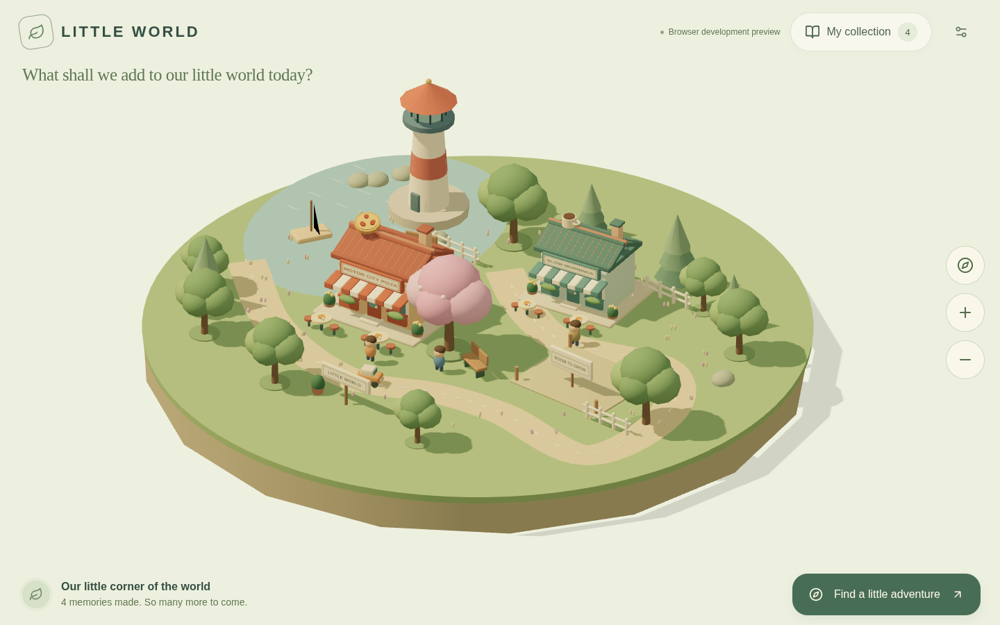

# LITTLE WORLD

**Drive the real world. Build your own.**

A local-first Pleos Connect proof of concept: an original procedural miniature town, a Detroit-to-Chicago pizza discovery loop, and a seven-second building reveal. No downloaded 3D assets, cloud accounts, API keys, live restaurant claims, or remote server at runtime.



## Run in a browser

Requires Node 22.12+ (or Node 20.19+) and npm.

```sh
cd web
npm ci
npm run dev
```

Open the printed localhost URL. This mode is explicitly labeled **Browser development preview** and is for use outside a vehicle.

To replay: **My collection → Detroit-style pizza → Meet your next keepsake → Find deep-dish pizza → choose a sample destination → Let’s go → Simulate journey → Add to my world**. Wait seven seconds for the reveal. **Not yet** leaves the collection unchanged. Use the sliders icon at the top right → **Reset demo world** to begin again. Buildings can also be tapped directly; the collection book is an accessible alternate way to inspect memories.

Drag to orbit, use two fingers to pan, and pinch, scroll, or use +/− to zoom. Camera orbit, pan, and zoom are bounded. Settings contains evening/daytime and sound controls. The compass button reframes the whole island. A deliberate interaction unlocks browser audio. Ambient motion is intentionally quiet.

## Build Android APKs

Requires a **JDK 17**, Android SDK platform **35**, build tools **35.0.0**, and a configured `ANDROID_HOME` or `android/local.properties` containing `sdk.dir=/your/android/sdk`. Gradle 8.10.2 is supplied by the checked-in wrapper. AGP 8.8.2 and Kotlin 2.1.10 are pinned.

```sh
./scripts/build-apk.sh preview
./scripts/build-apk.sh vehicle
```

Alternatively, after `npm ci` in `web`:

```sh
cd android
./gradlew :app:assemblePreviewDebug :app:assembleVehicleDebug
./gradlew :app:testPreviewDebugUnitTest :app:testVehicleDebugUnitTest
```

Every Android build runs the production Vite build and syncs `web/dist` into `app/src/main/assets/web`. Generated assets do not need to be checked in. Both APKs are debug-signed development artifacts, not market submissions.

| Flavor | Package | Behavior |
| --- | --- | --- |
| `preview` | `ai.littleworld.preview` | Explicit non-vehicle development preview; demo vehicle adapter; no vehicle permissions. Use on a development emulator only. |
| `vehicle` | `ai.littleworld` | Official NaviHelper 3.0.5 adapter. **World remains locked** because no trusted parked-state integration is available. No user-facing override. |

Outputs: `android/app/build/outputs/apk/{preview,vehicle}/debug/app-{preview,vehicle}-debug.apk`. Copies of the verified builds are in `artifacts/`.

```sh
adb install -r artifacts/little-world-preview-debug.apk
adb shell am start -n ai.littleworld.preview/ai.littleworld.MainActivity
```

For the vehicle build, replace the filename and package with `little-world-vehicle-debug.apk` and `ai.littleworld`.

## Vehicle display pass

The town fills the available landscape canvas, with a viewport-dependent camera fit and a gentler angle for wide screens. The large marketing headline and story overlay have been removed. A single short prompt, collection access, three camera controls, and one adventure action remain on the main screen. Interactive buttons are at least 56 logical pixels tall; main text, memory details, and actions use larger, higher-contrast type. Discovery panels resize the town's viewport instead of covering it; the primary action remains reachable while their content scrolls. Day/night and sound live in settings.

Screen tests cover 960×480, 1024×600, 1280×720, and 1920×720 with touch and 2× device pixel ratio. These are browser layout checks, not physical touch-target certification or Pleos GPU measurements. The world occupies more screen space, particularly on larger displays; the entire island stays visible on short displays. Future growth could add hand-authored neighborhoods when meaningful experiences are collected; automatic terrain expansion is not implemented.

## Architecture and trust boundaries

- `web/src/World.tsx`: original procedural assets, terrain, curved road, water, instanced flowers, idle motion, object selection, camera rig, and staged collection choreography. Rounded geometry and pastel materials share a consistent visual language. DPR is capped at 1.25; decorative shadow updates are capped at 15 Hz while motion continues at the display cadence. The world uses one shadow-casting directional light, low polygon decorations, and no postprocessing or particles.
- `web/src/App.tsx`: the single touch/browser UI, discovery state machine, explicit confirmation, lifecycle/safety gate, WebGL error boundary, and local-save feedback.
- `web/src/domain.ts`: typed extensible catalog for food, nature, landmarks, and culture; pure deterministic recommendations; versioned, validated local storage; duplicate prevention; reset. The island boundary is fixed in this POC: collecting fills the reserved plot. Time does not enlarge the island. The implemented collectible is Chicago; New York and the other suggestions are catalog previews.
- `web/src/bridge.ts`: versioned typed request/reply contract, runtime reply and safety validation, request correlation, and timeout fallback. JavaScript cannot submit coordinates or arbitrary URLs. It can request capabilities or one of three allowlisted sample destination IDs.
- `android/.../MainActivity.kt`: AndroidX WebViewAssetLoader serves **only** `https://appassets.androidplatform.net/assets/web/`. All non-asset requests are rejected. Navigation is blocked outside the fixed entry page. File/content access and mixed content are disabled. No `addJavascriptInterface`, unrestricted Android calls, or remote server.
- `PleosBridge.kt`: bounded messages, strict request version/type/ID/field validation, sample destination allowlist, and calls into the adapter. The origin-restricted AndroidX WebMessage listener accepts main-frame application content only; unsupported WebViews get no native bridge.
- `VehicleIntegration.kt`: typed navigation, location and parked/driving flows, lighting capability/authorization/restoration, and cleanup contract.
- `src/preview/...`: deterministic demo adapter; location and parked state are **unknown**, navigation unavailable, lighting unsupported.
- `src/vehicle/...`: real SDK initialization, permission check, route submission, callback registration, and release. Sample destinations are rejected. Real destinations are not exposed by the demo UI.

The production build injects a restrictive CSP: local scripts only, no frames or forms, no network data sources, and local/data/blob images. Fonts, all geometry, textures, and sound are generated or bundled locally. The Vite development server uses its usual refresh tooling; it is never loaded by Android.

## Safety and lifecycle

The world is stationary-only entertainment. The vehicle flavor starts and stays locked for UNKNOWN and DRIVING. It uses **both a native opaque safety cover** (hiding the WebView independently of JavaScript) and a web gate that unmounts the Canvas, cancels choreography, dismisses interaction, and suspends audio. There is no driving-mode override, speed-based parked inference, or fake parked signal.

The preview flavor permits UNKNOWN only because it is explicitly identified as a non-vehicle development preview. DRIVING is blocked even in preview. Do not install the preview flavor as an in-vehicle entertainment app.

On Android pause, native content is hidden, the safety event locks the web app, WebView/audio pause, and lighting restoration is requested. On resume, the current adapter state is republished. Teardown releases WebView, coroutine collection, listeners, and SDK resources. Confirmed memories are saved before choreography: if the app is interrupted, the confirmed shop is present on return and the animation is not replayed while driving.

No cabin lighting controls are exposed or invoked. Capability and restore methods currently return unavailable/no-op; any future lighting integration must require a deliberate user action, approved permissions, verified PARKED state, capability checks, and a restorable original state.

## Official Pleos baseline

Reviewed 2026-11-14:

- [Getting started](https://document.pleos.ai/en/docs/pleos-only/getting-started)
- [SDK overview](https://document.pleos.ai/en/docs/pleos-only/connect-sdk-pleos/)
- [Project and SDK access](https://document.pleos.ai/en/docs/pleos-only/create-my-project)
- [Development environment](https://document.pleos.ai/en/docs/connect/guide/getting-started/application-development/setup-connect-sdk-emulator)
- [Challenge development guide](https://appdevchallenge.auto-hmg.io/guide/development)
- [NaviHelper import](https://document.pleos.ai/en/docs/pleos-only/connect-sdk-pleos/NaviHelper/importing-sdk), [initialization](https://document.pleos.ai/en/docs/pleos-only/connect-sdk-pleos/NaviHelper/initialization-and-release), [permissions](https://document.pleos.ai/en/docs/pleos-only/connect-sdk-pleos/NaviHelper/declaring-permissions), [destinations](https://document.pleos.ai/en/docs/pleos-only/connect-sdk-pleos/NaviHelper/destinations)

The development guide specifies min API 28+, Gradle 8+, and a Pleos 2.1.0 emulator on API 34. This project uses **minSdk 28, targetSdk 34**, matching that documented emulator baseline, and compileSdk 35 for current AndroidX dependencies. Market target requirements must be reconfirmed before submission.

NaviHelper uses the official Maven repository and `ai.pleos.playground:NaviHelper:3.0.5`. Actual class packages and signatures were additionally inspected in the published AAR before compiling. The vehicle manifest declares only the documented `pleos.car.permission.NAVI_ROUTE_SEARCH`; declaring it does not imply it is granted. A successful submission is not treated as a completed route or arrival.

The project-access guide lists Vehicle Control and FusedLocation as not available yet. Neither dependency nor permission is invented here. NaviHelper's route/driving events do not establish transmission gear or a reliable parked state. A separately validated parked-state integration is required before enabling the vehicle world.

## Tests and evidence

```sh
cd web
npm test
npm run build
npm run test:e2e
```

Browser tests use Playwright and system Chromium at `/usr/bin/chromium`. Set `CHROMIUM_PATH` to your installed browser when needed. The software-rendering flags make CI deterministic; they are test-only. For tests against production output, run `npm exec vite preview -- --host 0.0.0.0 --port 5174`, then run `TEST_BASE_URL=http://localhost:5174 npm run test:e2e`. `node verify-rendering.mjs` additionally checks the production console, evening render, and WebGL failure UI on port 5174.

See [VERIFICATION.md](docs/VERIFICATION.md) for verified results, precise environment blockers, and the remaining on-device checklist. Screenshots are in `artifacts/`. This is a working browser POC with buildable native shells; it is not claimed as a Pleos-certified or hardware-performance-validated application.
