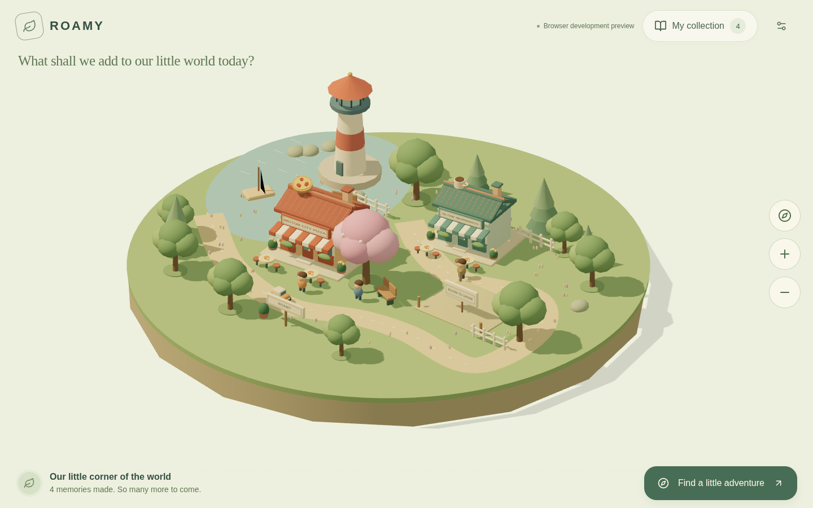
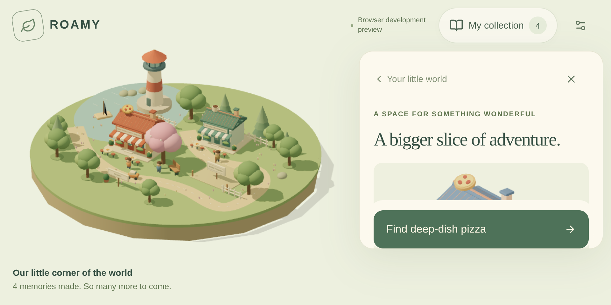

# ROAMY cloud validation

Date: 2026-11-15 (Asia/Seoul). All checks ran in the Codex cloud environment. This record supersedes historical test counts for the changes on `feat/roamy-cloud-readiness`; [VERIFICATION.md](VERIFICATION.md) remains the earlier proof-of-concept record.

## Fresh results

| Check | Result | Evidence |
| --- | --- | --- |
| Dependency install | `npm ci` passed with unchanged lockfile | Workspace npm cache used because the default home cache is unwritable |
| Web unit | **31 passed** across domain, bridge and preference tests | [web-unit.log](../artifacts/roamy-cloud/web-unit.log) |
| Production build | TypeScript and Vite passed | [web-build.log](../artifacts/roamy-cloud/web-build.log) |
| Browser E2E | **14 passed** against production output, Chromium/SwiftShader | [browser.log](../artifacts/roamy-cloud/browser.log) |
| Rendering | Day/evening, no production console/CSP errors, disabled-WebGL fallback passed | [rendering.log](../artifacts/roamy-cloud/rendering.log) |
| Android build | Preview and vehicle debug APKs built successfully | [android.log](../artifacts/roamy-cloud/android.log) |
| Native unit | **4 tests in each flavor; 8 passed executions** | [native-summary.json](../artifacts/roamy-cloud/native-summary.json) |
| Android lint | **0 errors; 5 warnings per flavor** | Summary includes exact warning IDs |
| APK integrity | Both signatures verified with `apksigner`; all 4 bundled production files byte-match `web/dist`; no extra bundled web files | SHA-256 hashes in native summary |
| Emulator acceleration | Failed: CPU exposes no `vmx`/`svm`; `/dev/kvm` absent | [emulator-accel.log](../artifacts/roamy-cloud/emulator-accel.log) |
| Official Pleos runtime | **Blocked / not run** | [feasibility report](EMULATOR_FEASIBILITY.md) |

The lint warnings are `OldTargetApi`, `GradleDependency`, `DiscouragedApi` (fixed landscape), `SetJavaScriptEnabled`, and `DataExtractionRules`. The official API 34 emulator baseline remains intentional; target policy/dependency/backup guidance still needs release review. No warning is treated as Pleos approval.

## What the regressions cover

- Full demo discovery, sample routing fallback, explicit cancellation/confirmation, seven-second reveal, collection/reload/reset and direct 3D selection.
- Confirmed collection survives safety interruption and reload without replaying the reveal.
- Vehicle UNKNOWN/DRIVING removes the web Canvas. Delayed native replies after driving, backgrounding or closing a panel do not reopen the journey; a subsequent request remains usable.
- Concurrent out-of-order replies resolve by request ID; malformed/unrelated replies, timeout, abort and throwing transports release request handlers/timers correctly.
- Actual calendar/leap-day checks, bounded memory text, duplicate prevention, disabled storage, corrupt saves, future-version preservation and explicit reset cancellation/confirmation.
- Visible session-only storage warning and retry; persistent day/evening, mute and motion preferences; panel focus and Escape focus restoration; reduced-motion immediate keepsake; accessible collection name and preview disclosure at narrow sizes.
- Layout/touch checks at 960×480, 1024×600, 1280×720 and 1920×720 with 2× device pixel ratio; camera controls and main action stay in bounds with at least 56 CSS-pixel targets. This is not a head-unit density certification.

## Screenshots

All screenshots below are **production web output in cloud Chromium using software WebGL**, not Pleos emulator captures.





Additional evening, collection, WebGL fallback and landscape-size images are in [artifacts/roamy-cloud](../artifacts/roamy-cloud/). Historical images/APKs directly under `artifacts/` were not replaced.

## Reproduce in the cloud

Install JDK 17, SDK platform 35/build-tools 35.0.0, Node 22.12+ and Chromium. This run used workspace-local Temurin 17 (verified vendor SHA-256), Google command-line SDK tools (verified published checksum), SDK emulator 37.2.13, and system Chromium. Java downloads/builds used the environment proxy and system Java trust store; certificate verification stayed enabled. The preinstalled Java 21 runtime lacked a compiler, so it could not build the app.

```sh
cd web
npm ci --cache /workspace/work/npm-cache
npm test
npm run build
TEST_PRODUCTION=1 EVIDENCE_DIR=../artifacts/roamy-cloud npm run test:e2e
# For the rendering script, start `npm exec vite preview -- --port 5174`
EVIDENCE_DIR=../artifacts/roamy-cloud node verify-rendering.mjs
cd ../android
./gradlew :app:assemblePreviewDebug :app:assembleVehicleDebug \
  :app:testPreviewDebugUnitTest :app:testVehicleDebugUnitTest \
  :app:lintPreviewDebug :app:lintVehicleDebug
```

Set `JAVA_HOME`, `ANDROID_HOME`, `GRADLE_USER_HOME`, `ANDROID_USER_HOME` and any required Java proxy/trust properties to workspace locations as appropriate. Do not put credentials into scripts or logs. `.github/workflows/cloud-validation.yml` runs unit/production-browser/native build checks and uploads screenshots, logs, APKs and reports. The new hosted workflow requires its own successful run; this document records the checks actually performed in this cloud session.

Current APKs are at `android/app/build/outputs/apk/{preview,vehicle}/debug/app-{preview,vehicle}-debug.apk`; they are debug-signed development artifacts. Package IDs remain `ai.littleworld.preview` and `ai.littleworld`; launcher labels are now ROAMY. The hashes in the summary identify this session's builds, not a reproducible release signing identity.

## Remaining limits and minimum user action

No AVD was created or booted, no device connected, and no APK installed/launched on Android. The attempted `adb devices` also encountered a read-only default user directory while initializing ADB; there is no successful connectivity result to report. There are no Pleos screenshots or device logcat logs. The primary infrastructure blockers remain absent nested KVM/CPU virtualization and GPU exposure; see the feasibility report for the official image URL/access check and CRN status.

Minimum platform action is a **cloud worker with usable KVM/nested virtualization and a supported GPU**. No local execution or CRN is requested. After that, use the official Pleos 2.1.0 API 34 image, cold boot, verify ADB, and execute the runtime matrix in the roadmap. Build/JVM/browser checks cannot verify SDK service binding, permissions, Android lifecycle, native cover while JavaScript stalls, real navigation or Pleos GPU behavior.

ROAMY is still a proof of concept: only Chicago is a new collectible, all UI destinations are sample data, live routing/arrival is not exposed, and the vehicle's trusted parked-state provider remains unimplemented. Vehicle UNKNOWN/DRIVING stays locked; no safety overrides, invented PARKED signals or cabin controls were added.
