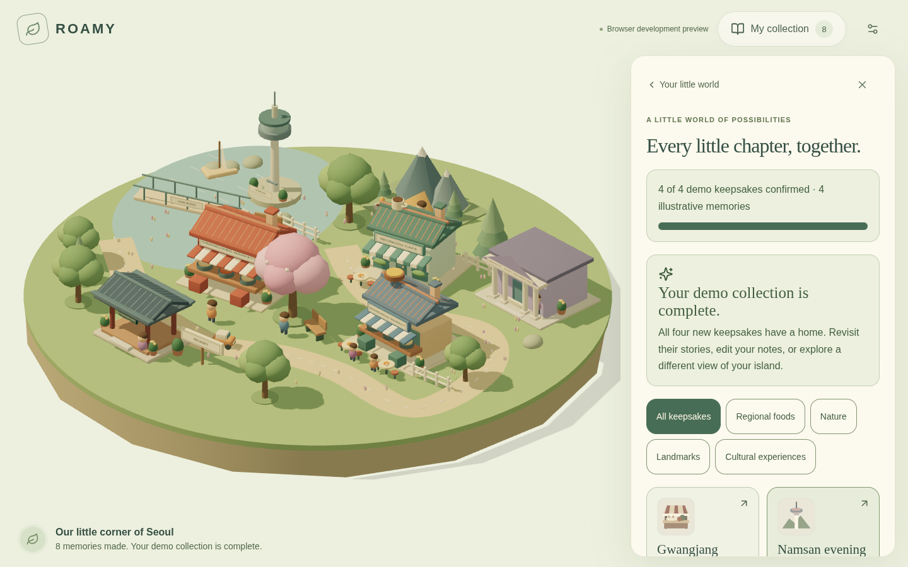
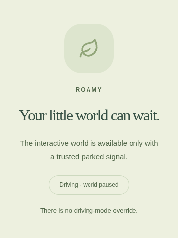

# ROAMY Seoul design validation

Cloud production-browser audits, 2026-11-15. This reviews the actual Seoul application, not a mockup. The current journey refinement and the earlier integration baseline are versioned separately below. The goal is to understand a seeded memory, discover a related experience, explicitly confirm a demonstration keepsake, and recover or edit local data safely.

Final capture acceptance and media verification are recorded in the adjacent evidence manifests. Browser evidence does not establish Pleos runtime compatibility, native safety behavior, physical touch-target size, speaker/audio behavior, or full accessibility compliance.

## Latest source: short-screen collection correction

The final 960×480 regression exposed a real collection issue after the journey refinement below: long introductory and empty-state copy put the first card below the viewport. The UI now uses a direct **My collection** heading, concise group provenance and tighter short-screen spacing. Confirmed demos, seeded illustrations, their dates and their counts remain distinct. The existing regression assertion is unchanged.

[Watch the current compact collection](../artifacts/roamy-seoul/design/short-collection-fix/short-collection-fix-walkthrough.mp4): **51.73s, 960×480, 0.31 MB**, frozen source `e3ca04b`. This is the authoritative collection-layout evidence; the longer journey recording below predates this final compaction. The silent continuous recording explicitly uses system reduced motion, actual UI confirmation and no injected world or parked state. Inspection pauses remain; playback speed is unchanged.

| Step | Inspected current result | Screenshot |
| --- | --- | --- |
| 1. Open initial collection | Empty confirmed group and seeded provenance remain explicit; first illustration is visible and hit-test reachable without scrolling. | [Initial collection](../artifacts/roamy-seoul/design/short-collection-fix/short-collection-fix-01-initial-collection.png) |
| 2. Select first memory | The exposed card opens the intended Gwangjang illustration and names its collection return. | [Memory](../artifacts/roamy-seoul/design/short-collection-fix/short-collection-fix-02-selected-memory.png) |
| 3. Return to collection | Back restores the compact heading and groups; the first illustration remains reachable without scrolling. | [Back](../artifacts/roamy-seoul/design/short-collection-fix/short-collection-fix-03-collection-back.png) |
| 4. Confirm a demo | A real simulated journey and explicit confirmation place the new demo first, with its date and readable provenance. Its first card is immediately reachable. | [Confirmed first](../artifacts/roamy-seoul/design/short-collection-fix/short-collection-fix-04-confirmed-first-card.png) |

All four screenshots and all four decoded video frames were visually inspected. Full-video decoding and generic read-only media verification pass. The [step manifest](../artifacts/roamy-seoul/design/short-collection-fix/short-collection-fix-manifest.json) records hit-test success and card bottoms of **465.30px** initially/after Back and **359.47px** after confirmation, within the 480px viewport; no scroll operation occurs before those assertions. [Media verification](../artifacts/roamy-seoul/design/short-collection-fix/media-validation.json) retains hashes, timestamps and frame notes.

[Seven targeted browser checks passed](../artifacts/roamy-seoul/design/short-collection-fix/targeted-tests.log) in 30.5s on the built production fix: the unchanged short collection regression, three viewport layout/readability checks, collection grouping/order, contextual recommendation returns and chosen-stop/note persistence. Current assets: `index-DXWuR4Xv.js` and `index-CBa8XcW_.css`; exact hashes are in the manifest. Earlier captures are retained with their original identities. This browser correction does not establish Pleos runtime capability.

## Journey refinement before final collection compaction

[Watch the current-source journey](../artifacts/roamy-seoul/design/journey-refinement/journey-refinement-walkthrough.mp4): **3m30s, 1440×900, 2.84 MB**, captured from frozen source `9f389af` at the root production preview. All **16 sequential screenshots plus two responsive screenshots** were individually inspected; seven decoded video frames were also inspected. The full MP4 decodes successfully. This silent continuous recording uses actual UI actions, a nondefault sample-stop choice, normal motion and a full timed reveal. No completed world, verified visit or parked state was injected. It retains inspection pauses and one recorder exact-toast lookup retry after the application had completed normally; there were no application page errors.

| Journey | Verified result | Current evidence |
| --- | --- | --- |
| 1. Understand the collection | Starter illustrations and confirmations are separated; the new demo appears in the first group without implying a verified visit. | [Initial groups (0:23)](../artifacts/roamy-seoul/design/journey-refinement/journey-refinement-02-grouped-collection.png), [confirmed first (2:02)](../artifacts/roamy-seoul/design/journey-refinement/journey-refinement-09-confirmed-first-group.png) |
| 2. Recollect, then discover | The selected quote precedes a concise named curated pairing. Discovery names its source and Back restores that memory. | [memory first (0:31)](../artifacts/roamy-seoul/design/journey-refinement/journey-refinement-03-memory-first-recommendation.png), [next chapter (0:41)](../artifacts/roamy-seoul/design/journey-refinement/journey-refinement-04-named-next-chapter.png), [source return (0:49)](../artifacts/roamy-seoul/design/journey-refinement/journey-refinement-05-source-memory-return.png) |
| 3. Choose and explicitly confirm | The selected Han River sample stop carries into unavailable navigation; simulation and collection consent remain deliberate. | [nondefault choice (1:00)](../artifacts/roamy-seoul/design/journey-refinement/journey-refinement-06-chosen-sample-destination.png), [chosen journey (1:07)](../artifacts/roamy-seoul/design/journey-refinement/journey-refinement-07-chosen-simulated-journey.png), [confirmation (1:19)](../artifacts/roamy-seoul/design/journey-refinement/journey-refinement-08-explicit-demo-confirmation.png) |
| 4. Reload and understand provenance | After reload the chosen sample stop persists; its qualifier and the separate demo confirmation date are explicit. | [reloaded stop (2:15)](../artifacts/roamy-seoul/design/journey-refinement/journey-refinement-10-reloaded-chosen-stop.png), [stop and date (2:32)](../artifacts/roamy-seoul/design/journey-refinement/journey-refinement-12-saved-stop-date-provenance.png) |
| 5. Edit and verify | Save focuses the exact updated Unicode quote and persistent status. A second real reload preserves the note. | [saved quote (2:21)](../artifacts/roamy-seoul/design/journey-refinement/journey-refinement-11-saved-note-verification.png), [reloaded note (3:00)](../artifacts/roamy-seoul/design/journey-refinement/journey-refinement-14-reloaded-edited-note.png), [short saved quote](../artifacts/roamy-seoul/design/journey-refinement/responsive-01-short-saved-quote.png) |
| 6. Return without losing context | Memory Back returns to its collection or all-keepsakes origin, with correct confirmed progress. | [collection return (2:42)](../artifacts/roamy-seoul/design/journey-refinement/journey-refinement-13-collection-return.png), [catalog detail (3:05)](../artifacts/roamy-seoul/design/journey-refinement/journey-refinement-15-browse-detail-context.png), [catalog return (3:24)](../artifacts/roamy-seoul/design/journey-refinement/journey-refinement-16-browse-return.png) |

The dedicated [three-viewport regression run](../artifacts/roamy-seoul/design/journey-refinement/layout-tests.log) passed in 19.9s at 1440×900, 960×480 and 360×480. It checks header label containment and Settings separation, illustration/confirmation semantics, memory-first reading order, rationale bounds/contrast ≥4.5:1 and exact saved-quote focus/visibility below the sticky header. The [fresh narrow header](../artifacts/roamy-seoul/design/journey-refinement/responsive-02-narrow-header.png) confirms the corrected compact count. Narrow visual counts show demos; the full accessible label and collection retain illustration counts.

[Current step manifest](../artifacts/roamy-seoul/design/journey-refinement/journey-refinement-manifest.json) · [current media verification](../artifacts/roamy-seoul/design/journey-refinement/media-validation.json). Current assets: `index-DCyRyVFv.js` and `index-Cf8Zrivz.css`; exact hashes are in those manifests. The baseline assets and media below remain unchanged. The baseline 55-state contrast scan is historical; the focused current viewport checks cover the newly introduced surfaces.

**Remaining limits:** this remains a curated demonstration collection, not a verified visited-places history or personalized live recommendation service. Detailed facts, confirmations and recommendation text still require scrolling on short screens. Future real integrations must preserve the distinction between a demo choice, a user note and evidence of a real visit. Vehicle runtime, audio, physical scaling and accessibility limits below still apply.

## Integration baseline walkthroughs

[Main: real UI journey to all eight keepsakes](../artifacts/roamy-seoul/design/main-walkthrough.mp4) · [Short landscape: edit, export, reset, recovery and licenses](../artifacts/roamy-seoul/design/short-walkthrough.mp4) · [Narrow: evening, invalid import, cancel and restrictive safety test](../artifacts/roamy-seoul/design/narrow-walkthrough.mp4).

Recordings are silent, continuous Playwright screen captures. H.264 conversion drops frames to 15 fps without speeding up, trimming or changing the recorded sequence; this is not an FPS benchmark. The main recording uses ordinary motion and actual seven-second reveals; short/narrow recordings use the system reduced-motion preference. Main collection completion uses UI actions only, with no injected world, timer acceleration or fabricated PARKED signal. Time spent inspecting screenshots remains in the recordings. No sign-in, credentials, private project identifiers, or real customer data appear.

[Media verification](../artifacts/roamy-seoul/design/media-validation.json) records durations, sizes, hashes, full-decode checks and inspected decoded frames. Step-by-step timestamps, DOM assertions and image inspection notes: [main](../artifacts/roamy-seoul/design/main-manifest.json), [short](../artifacts/roamy-seoul/design/short-manifest.json), [narrow](../artifacts/roamy-seoul/design/narrow-manifest.json).

## Numbered flows

Each row groups related screens; the linked manifests retain every numbered capture, DOM state, inspection note and approximate video timestamp. The following 28 baseline screenshots were inspected individually against the frozen production build; no page errors occurred in the three completed contexts. Health describes the captured browser flow, with remaining limitations stated explicitly.

| Flow | Review and health | Screenshot evidence |
| --- | --- | --- |
| 1. Start and collection | Healthy. World renders; mode disclosure and four dated illustrative memories are visible. | [Start](../artifacts/roamy-seoul/design/main-01-clean-start.png), [collection](../artifacts/roamy-seoul/design/main-02-collection.png) |
| 2. Memory and discovery | Healthy with refinement. Art fits; facts and provenance are legible. The next action is clear, although its explanatory rationale can require scrolling. | [Gwangjang memory](../artifacts/roamy-seoul/design/main-03-gwangjang-memory.png), [Mangwon preview](../artifacts/roamy-seoul/design/main-04-mangwon-discovery.png) |
| 3. Sample journey and consent | Healthy demo contract. Sample venues/distances, unavailable live routing, deliberate simulation and explicit collection consent stay distinct. | [Destinations](../artifacts/roamy-seoul/design/main-05-sample-destinations.png), [routing unavailable](../artifacts/roamy-seoul/design/main-06-navigation-unavailable.png), [confirmation](../artifacts/roamy-seoul/design/main-07-explicit-confirmation.png) |
| 4. Timed reveal and result | Healthy. Actual timed reveal has readable caption/progress; success names the new keepsake and controls re-enable. | [Reveal](../artifacts/roamy-seoul/design/main-08-seven-second-reveal.png), [Mangwon collected](../artifacts/roamy-seoul/design/main-09-mangwon-collected.png) |
| 5. All eight keepsakes and completion | Healthy. Four distinct new assets are collected through real confirmations. Browse and completion open at their headings with the correct four-of-four summary. | [Browse](../artifacts/roamy-seoul/design/main-10-browse-all.png), [palace](../artifacts/roamy-seoul/design/main-11-palace-collected.png), [Bukhansan](../artifacts/roamy-seoul/design/main-12-bukhansan-collected.png), [museum](../artifacts/roamy-seoul/design/main-13-museum-collected.png), [complete](../artifacts/roamy-seoul/design/main-14-complete-collection.png) |
| 6. Short-screen editing and recovery | Healthy with scrolling. Save/Cancel avoid discovery overlap; exported text remains accessible; reset and recovery require confirmation. DOM assertions verify the exact note survives. After Save the quote remains above the current scroll position. | [Short start](../artifacts/roamy-seoul/design/short-01-short-start.png), [edit](../artifacts/roamy-seoul/design/short-02-memory-edit.png), [saved note](../artifacts/roamy-seoul/design/short-03-edited-memory.png), [export](../artifacts/roamy-seoul/design/short-04-backup-export.png), [reset review](../artifacts/roamy-seoul/design/short-05-reset-review.png), [recovery review](../artifacts/roamy-seoul/design/short-06-recovery-review.png), [restored note](../artifacts/roamy-seoul/design/short-07-restored-note.png) |
| 7. Evening and bundled notices | Healthy. Evening disclosure/footer use opaque surfaces. Real bundled license text opens in a focused, scrollable Settings reader. | [Evening](../artifacts/roamy-seoul/design/short-08-evening.png), [licenses](../artifacts/roamy-seoul/design/short-09-bundled-licenses.png), [narrow evening](../artifacts/roamy-seoul/design/narrow-01-narrow-evening.png) |
| 8. Narrow error recovery and safety contract | Healthy within browser scope. Invalid import is readable/non-destructive; actual cancellation preserves four memories. Replacement details and actions require scrolling. Restrictive driving-event test removes Canvas and controls. | [Invalid backup](../artifacts/roamy-seoul/design/narrow-02-invalid-backup.png), [import review](../artifacts/roamy-seoul/design/narrow-03-import-review.png), [cancel](../artifacts/roamy-seoul/design/narrow-04-import-cancelled.png), [browser safety test](../artifacts/roamy-seoul/design/narrow-05-browser-safety-test.png) |

## Findings addressed in this audit

- **Cropped memory art:** the wrapped vector inherited the old emoji layout and extended outside its illustration frame. The final CSS gives the wrapper explicit dimensions. [Before](../artifacts/roamy-seoul/design/before/main-03-gwangjang-memory.png); final comparison is flow 2. A browser regression checks bounds and the full eight-keepsake path checks every icon.
- **Evening text contrast:** preview and footer labels were approximately 3.17–3.20:1 against the canvas background. Opaque dark header/footer surfaces and a matching prompt capsule improve the text background without changing the world palette. [Before](../artifacts/roamy-seoul/design/before/night-before.png); final comparisons are flow 7. Narrow text-background checks account for actual ancestor coverage.
- **Muted status and secondary labels:** the scan found normal-sized labels around 3.5–4.45:1 in selected destination cards, collection titles, progress legends and settings. The reveal caption and progress stripe also needed stronger contrast. The selected functional text now targets 4.5:1; meaningful progress fills target 3:1 against their tracks. [Reveal before](../artifacts/roamy-seoul/design/before/main-08-seven-second-reveal.png).
- **Retained panel scrolling:** moving from a scrolled album into browsing could leave its heading or completion summary hidden. The panel now returns to its top on a content change. [Before](../artifacts/roamy-seoul/design/before/main-14-complete-collection.png); final comparison is flow 5.

## Journey findings from the integration baseline

The following findings describe the baseline above. The focused journey refinement is tracked separately below; these are not claims of verified vehicle capability:

- **Visited places:** the current collection combines explicitly seeded illustrations and confirmed demo keepsakes. It is not a verified visited-places history. A future real-service journey should distinguish verified visits, personal notes and demonstration records before recommending places.
- **Recommendation rationale:** the related Gwangjang → Mangwon story is coherent, but the sticky action can appear while its explanation is below the fold. Consider a short visible reason beside that action and a clear return to the originating memory.
- **Save verification:** saving announces success but retains the editor scroll position, leaving the updated quote above the viewport. Scroll/focus the updated note or offer a visible “View updated note” action.
- **Compact confirmations:** narrow recovery/import previews are readable but long. Keep the summary and deliberate Cancel/Confirm choices discoverable without obscuring the safeguards; scrolling remains necessary in the current fallback.

## Checks and limits

Nine additional design E2Es pass within the integrated 44-test browser suite (two cases were rerun alone after initial contention/expectation issues). The final computed audit sampled **55 state/scroll positions with zero functional-text threshold failures**; [raw scoped results](../artifacts/roamy-seoul/design/contrast-audit.json). The dedicated design suite covers icon bounds and readable facts; day/evening text; selected/unselected destination semantics; real reveal/status/progress contrast; every current keepsake; bounded Unicode edits; unavailable-clipboard recovery; interrupted unconfirmed imports; and keyboard-readable local licenses. These supplement the domain, native and existing browser suites; exact final counts belong in the repository's cloud validation record.

The computed contrast audit samples panel scroll positions across day/evening start, collection, memory, discovery, destinations, journey, arrival, browsing, backup/error and browser safety states, plus actual timed-reveal colors. Decorative repeated postmark text is reported separately; disabled controls and decorative art are excluded from the functional-text pass. Computed colors and screenshots do not establish contrast against every animated canvas pixel, native control internals, screen-reader behavior, or complete WCAG conformance.

Large browser controls and keyboard checks are useful evidence, but CSS pixels do not certify head-unit physical density. Short screens require scrolling for detailed data and recovery confirmations. The collection remains the readable alternative to small decorative 3D signs. The narrow safety step is a **browser event test**, not vehicle telemetry or a Pleos test; it never fabricates PARKED.

The official Pleos runtime, GPU/thermal performance, native service binding and cabin audio still require the upgraded cloud worker described in [EMULATOR_FEASIBILITY.md](EMULATOR_FEASIBILITY.md).

Baseline production identity: `index-bs_eDp8G.js` / `index-CFNyFp_I.css`; exact SHA256 values are retained in every capture manifest. Bundled notices: 101,857 bytes, SHA256 `c022b59652eb7764c4e0535ed65cc6a85839d959b66d950c2fca782568aca37e`.

## Review and reproduction

The recordings are approximately 6m22s (1440×900), 2m30s (960×480), and 1m37s (360×480). Every MP4 decoded without errors. Twelve decoded frames were visually inspected; the frame-level timestamps and notes are in the media manifest. Full-resolution PNGs preserve sharper text than the compressed videos.

With a production preview already running, `cd web` and run `TEST_BASE_URL=http://localhost:5174 node record-design.mjs`. It accepts one JSON command per line: `{"action":"main-start"}`, then an explicit `{"action":"accept","health":"healthy","note":"Observed screenshot finding"}` after viewing the returned PNG. The recorder selectors track the current source; earlier baseline manifests retain the labels actually captured at that revision. Follow the named actions in the recorder source; `finish` closes the active recording and `quit` closes Chromium. `short-start` and `narrow-start` open clean independent contexts. `TEST_BASE_URL=http://localhost:5174 node audit-design-contrast.mjs` repeats the computed state scan. `python3 verify-design-media.py --help` documents verification options. The default verifies the committed manifest and MP4s without changing accepted evidence; raw-recording comparison is optional. Explicit frame extraction uses a new directory and preserves accepted inspection notes. Raw recordings remain cloud scratch evidence; accepted H.264 files are committed here.
